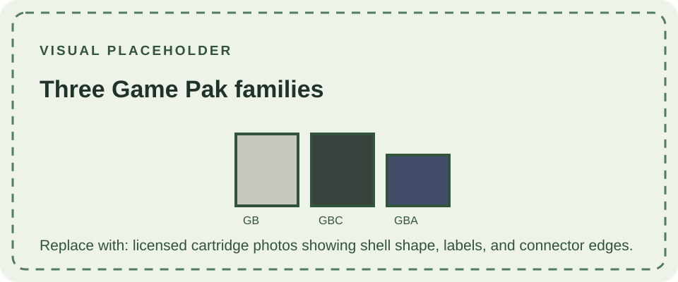
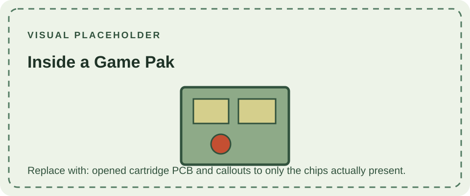

Game Boy cartridges—called **Game Paks** in Nintendo manuals—carry the game software and, when needed, additional hardware. A cartridge can contain ROM, a memory bank controller, save memory, a clock, or a game-specific component. The cartridge format changed with the Game Boy Advance, so a cartridge that fits one generation does not necessarily fit or run on another.

## Cartridge families at a glance

| Cartridge family | Physical format | Systems that support it | Important limits |
| --- | --- | --- | --- |
| Original Game Boy | Tall DMG-style Game Pak | Game Boy DMG-01, Pocket, Light, Color, Advance, and Advance SP; Super Game Boy and Game Boy Player accessories | DMG, Pocket, and Light run the monochrome version. Color and Advance can apply color palettes or enhancements when the game supports them. |
| Game Boy Color | Same tall cartridge format; commonly gray, black, or clear shells | Game Boy Color; Game Boy Advance and Advance SP for compatible titles; Game Boy Player | A Color-exclusive Game Pak needs Color-capable hardware. Dual-mode releases can also run in monochrome mode on older Game Boy systems. |
| Game Boy Advance | Shorter, smaller AGB Game Pak | Game Boy Advance, Advance SP, Micro, and Game Boy Player | Not compatible with DMG, Pocket, Light, or Color. The Micro accepts this family only. |

Shell color is a useful clue, not a complete compatibility test. Gray cartridges are generally original Game Boy releases; black cartridges often indicate dual-mode Game Boy / Color software; clear cartridges are commonly Color-exclusive. Exceptions and regional variations exist, so check the cartridge label, header data, and game documentation.

## How a cartridge works

The console reads program data from ROM through the cartridge connector. Small games may fit in the address range exposed directly by the system. Larger games use a **memory bank controller (MBC)** or another mapper to switch which ROM or RAM bank is visible at a time. The cartridge header identifies the declared cartridge type and ROM/RAM size; it is a valuable starting point for software tools and hardware research.

The Game Boy and Game Boy Color cartridge families use several controller designs. Common families include Nintendo's MBC1, MBC2, MBC3, and MBC5; other licensed cartridges use different controllers, and specialist titles can add sensors, rumble, or other hardware. Controller capabilities are not interchangeable: a game's size, save type, clock, or peripheral feature determines what its board must provide.

Game Boy Advance Game Paks use a different, smaller connector and a different system bus. They contain the game ROM and may include save memory such as SRAM, flash memory, or serial EEPROM. A GBA save type is separate from the older GB/GBC MBC system, even when the player experience—saving progress—looks similar.

## Saving progress

Many early Game Boy cartridges have no save memory and use passwords or stage codes instead. A cartridge that saves progress may use **battery-backed SRAM**; the battery maintains the memory while the game is off. When that battery is depleted, the game may still run but the save can be lost or fail to persist. Replacing the battery does not recover data that has already disappeared.

Other cartridges use nonvolatile save technologies such as flash memory or EEPROM, which do not need a backup battery to retain saves. Some cartridges combine a save system with a real-time clock or another feature. Do not infer the save method from the shell color or game title alone: use the cartridge type reported in its header, inspect the board when appropriate, and compare it with reliable documentation.

GBA cartridges commonly store saves in SRAM, flash, or EEPROM. Games that use a clock or other hardware need the corresponding cartridge components as well. Save readers and flash tools must support the specific memory type; a generic cartridge dump may contain the ROM but not correctly capture or restore every save feature.

## Compatibility by console

- **Game Boy DMG-01, Pocket, and Light:** play original Game Boy cartridges. A dual-mode release can provide its older-compatible game mode; a Color-exclusive Game Pak cannot run as a normal game on these systems.
- **Game Boy Color:** plays original Game Boy software and Color-capable software. Older games may receive a selected color palette, while dual-mode and Color-exclusive games use Color features according to their design.
- **Game Boy Advance and Advance SP:** accept GBA cartridges and retain a legacy mode for original Game Boy and Color cartridges. Nintendo's manual notes that a few Game Boy Series Game Paks may not work properly, so backward compatibility is broad but not absolute.
- **Game Boy Micro:** plays GBA cartridges only. It has no legacy hardware or slot for original Game Boy and Color Game Paks.
- **Super Game Boy / Super Game Boy 2:** SNES accessories that run compatible original Game Boy cartridges. Certain games provide enhanced borders, palettes, or other Super Game Boy features.
- **Game Boy Player:** GameCube accessory that supports Game Boy, Color, and Advance Game Paks. Accessory-specific features and individual game behavior can still vary.

For the console-side slot, see the [DMG-01 cartridge-slot page](/consoles/dmg-01/physical-design/cartridge-slot/). The system overviews for [Game Boy Color](/consoles/game-boy-color/), [Game Boy Advance](/consoles/game-boy-advance/), [Advance SP](/consoles/game-boy-advance-sp/), and [Micro](/consoles/game-boy-micro/) describe their respective compatibility boundaries.

## Identification and care

Record the front label, rear label, shell color, printed product codes, and any region markings. For a technical record, also capture the ROM header data, cartridge-board identifier, controller IC, ROM and save-memory markings, and whether the cartridge has a battery, clock, sensor, or rumble component. A shell may have been replaced, so internal markings provide stronger evidence about the board than plastic color alone.

Keep contacts clean and dry, and insert the cartridge straight without forcing it. If a game fails to start, check the contacts and cartridge condition before assuming the console is incompatible. Avoid scraping contacts or using liquids that can leave residue. For battery-backed saves, document the existing save status before any repair that involves the battery or board.

## Technical references

- [Pan Docs: The Cartridge Header](https://github.com/gbdev/pandocs/blob/master/src/The_Cartridge_Header.md) — header fields, cartridge type, and hardware requirements.
- [Pan Docs: MBC1](https://gbdev.io/pandocs/MBC1.html) — an example of cartridge memory banking and controller behavior.
- [Nintendo Game Boy Advance instruction manual](https://www.nintendo.com/eu/media/downloads/support_1/game_boy_advance_4/GBA_Manual_UK_DE_FR.pdf) — compatibility guidance for earlier Game Boy and Color Game Paks, including known exceptions.
- [Game Boy Complete Technical Reference](https://gekkio.fi/files/gb-docs/gbctr.pdf) — hardware reference across Game Boy models and cartridges.
