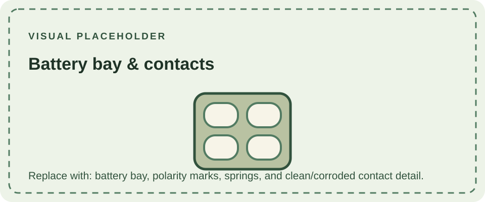

The DMG-01 is powered by four AA cells installed in the rear battery compartment. The molded polarity marks show the orientation of each cell; follow those marks rather than assuming all cells face the same way. Nintendo's operating instructions specify alkaline AA batteries and caution against mixing old and new cells or different battery types.

Spring and flat contacts connect the cells to the console's power circuitry. Leakage, corrosion, or a weak contact can interrupt power or cause intermittent operation. Inspect for residue and damaged springs before diagnosing a fault elsewhere. Battery contacts and their wiring are part of the power path, not the same thing as the external DC input.

The console also accepts an external DC supply through its power jack. Use a supply that matches the console's required polarity and electrical rating; do not infer compatibility from the plug fitting. Regional adapters may differ. Remove batteries when storing a console for an extended period, especially if their condition is uncertain.

The compartment is part of the DMG-01 [physical design](/consoles/dmg-01/physical-design/shell-housing/overview/). Later systems changed battery formats: the [Game Boy Pocket](/consoles/game-boy-pocket/) uses two AAA cells, while the [Game Boy Light](/consoles/game-boy-light/) uses two AA cells.

