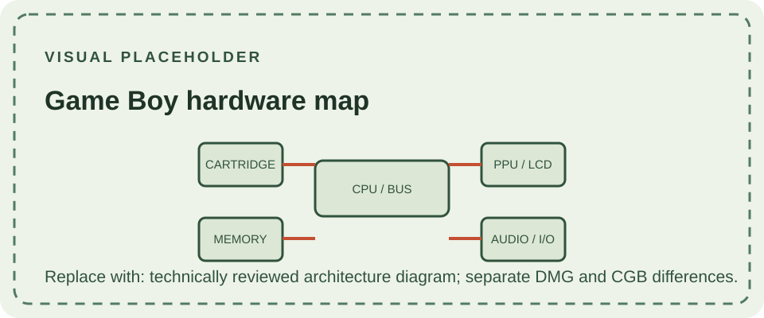

The DMG-01 is a cartridge-based handheld built around Nintendo's DMG-CPU, a Sharp-manufactured 8-bit processor and graphics system. It combines fixed internal memory, a reflective monochrome LCD, a four-channel sound unit, and external cartridge and serial interfaces. The figures below describe the original DMG model; later Game Boy systems have different capabilities.

## Core specifications

| Subsystem | DMG-01 specification |
| --- | --- |
| Processor | Nintendo DMG-CPU, commonly identified with Sharp LR35902; 8-bit custom processor |
| Clock | 4.194304 MHz system clock |
| Work RAM | 8 KiB internal work RAM |
| Video RAM | 8 KiB |
| Display | Reflective LCD, 160 × 144 pixels, four on-screen shades, no backlight |
| Audio | Four programmable sound channels; mono built-in speaker and stereo headphone output |
| Game media | Removable Game Pak; ROM capacity and optional mapper, RAM, or other hardware depend on the cartridge |
| Power | Four AA batteries or an external DC supply |
| Interfaces | Cartridge connector, serial link port, headphone jack, and external power input |

## How the system works

The processor executes code from the cartridge and coordinates the system through a memory-mapped address space. The cartridge can add hardware such as a memory bank controller or save RAM, so its capabilities are not fixed by the console alone. The DMG's internal work RAM and video RAM provide working storage for game logic and graphics data.

The graphics hardware reads tile and sprite data from video memory and renders a 160 × 144 image. The LCD is reflective and uses a four-shade palette, so it depends on ambient light rather than a built-in backlight. The display and board assemblies changed over the console's production life; see [LCD Display](/consoles/dmg-01/physical-design/lcd-display/) and [PCBs & Revisions](/consoles/dmg-01/pcbs-revisions/dmg-cpu-01/) for those physical differences.

The sound unit provides two pulse channels, one programmable wave channel, and one noise channel. Its output is routed to the internal mono speaker or, through the headphone jack, stereo headphones. The serial link port supports communication with compatible consoles and accessories; the software or peripheral determines the protocol used.

## References

- [Nintendo Game Boy Programming Manual](https://files.nekoblog.org/uploads/pdf/39999184-GameBoy-Programming-Manual.pdf) — Nintendo's software-development reference for the system's memory map, display, and sound registers.
- [Pan Docs](https://gbdev.io/pandocs/) — maintained technical reference for Game Boy hardware behavior.
- [Game Boy Complete Technical Reference](https://gekkio.fi/files/gb-docs/gbctr.pdf) — detailed reference covering hardware families and revisions.

For enclosure features and connectors, see [Physical Design](/consoles/dmg-01/physical-design/shell-housing/overview/). For the cartridge interface and compatibility, see [Cartridge Slot](/consoles/dmg-01/physical-design/cartridge-slot/) and [Game Boy Cartridges](/cartridges/game-boy-cartridges/).
