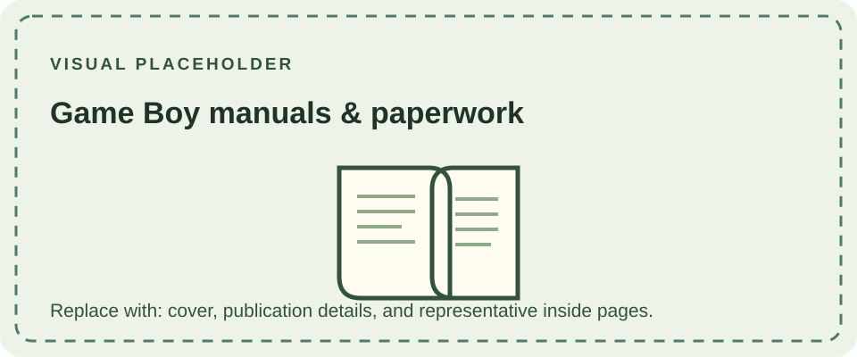

This is an initial, non-exhaustive inventory of official system manuals and printed notices associated with the DMG-01. Nintendo used different identifiers for the system guide, instruction booklet, and safety leaflet; the codes below are transcribed from scans or collector references and should not be treated as interchangeable.

| Item | Region / language | Printed code | Record and notes |
| --- | --- | --- | --- |
| Compact Video Game System Owner's Manual | USA / English | `DMG-GB-USA-1` | [Scanned manual and cover](https://manualzz.com/doc/22866609/nintendo-game-boy-handheld-game-console-user-manual). The scan identifies Nintendo of America and “Printed in Japan.” |
| Game Boy instruction booklet | USA / English | `GA-DMG-USA-2` | [Code record](https://dmgpage.com/2015/01/20/dmg-codes-betriebsanleitungen/). Catalogued separately from the owner’s manual; verify the exact cover and revision against the physical copy. |
| Bedienungsanleitung (system manual) | Germany / German | `GA-DMG-NOE` | [Code record](https://dmgpage.com/2015/01/20/dmg-codes-betriebsanleitungen/). A Play It Loud! special-edition manual is also listed as `SE-DMG-NOE`. |
| Consumer Information and Precautions booklet | USA, France, Spain / multilingual | `DMG-USA-2`, `DMG-USA-6` | [Regional code list](https://dmgpage.com/2015/01/20/dmg-codes-betriebsanleitungen/); the suffixes indicate documented print variants. |
| Consumer Information and Precautions booklet | Europe / multilingual | `DMG-EUR`, `DMG-EUR-1`, `DMG-EUR-2` | [Regional code list](https://dmgpage.com/2015/01/20/dmg-codes-betriebsanleitungen/), listing English, French, German, Italian, Spanish, Dutch, Swedish, Danish, and Finnish language combinations. |

### Photograph and scan provenance

The linked manual scan is hosted by Manualzz, which reproduces a Nintendo of America booklet; the code list is a collector-maintained transcription, not a Nintendo master bibliography. Use each link as a visual reference, then record the cover, back page, language, printed code, revision, and any owner or collection provenance for a physical copy. Images in this archive remain placeholders until photographs with permission and a clear source are added.

Do not assume that a document found with a console was originally packed with that exact unit. Record bundle contents separately, and distinguish original Nintendo print from retailer inserts, later reprints, and reproductions.
