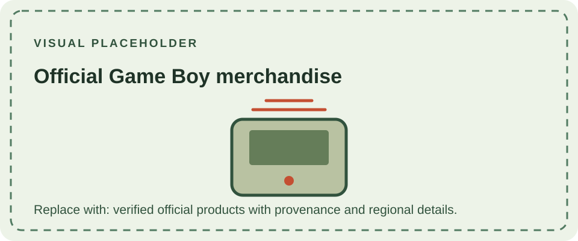

This initial inventory covers official Nintendo accessories and selected licensed products documented for use with the DMG-01. Product codes and regional releases are taken from the cited records; they are not a complete catalogue of every accessory or promotional item. “Licensed” items are identified separately from Nintendo-made products.

## Nintendo products

| Product | Code | Region / date in the cited record | Description | Photo record / provenance |
| --- | --- | --- | --- | --- |
| Stereo Headphones | `DMG-02` | Japan / 1989 | Official stereo headphones, also included with some console bundles. | [Photographed Japanese release](https://www.gameboymuseum.com/game-boy-hardware-guide/accessories/dmg-02/game-boy-stereo-headphones); museum record identifies Nintendo as publisher. |
| Rechargeable Battery Pack | `DMG-03` | Japan / 1989 | Four-cell rechargeable pack that can also provide external power; regional mains-plug variants exist. | [Photographed Japanese release and regional notes](https://www.gameboymuseum.com/game-boy-hardware-guide/accessories/dmg-03/game-boy-rechargeable-adapter). |
| Interactive Play-Cable / Game Link Cable | `DMG-04` | Japan / release year not confirmed | Original cable for connecting two DMG systems. The US and UK retail packages have separate product identifiers. | [Japanese product record and photo](https://www.gameboymuseum.com/game-boy-hardware-guide/accessories/dmg-04/game-boy-interactive-play-cable); [US package record](https://www.gameboymuseum.com/game-boy-hardware-guide/accessories/dmg-a-gl-21647/game-boy-game-link-cable-%28usa%29). |
| Shielded Game Link Cable | `DMG-04A` | Japan / release year not confirmed | Revised, shielded cable variant. | [Photographed product record](https://www.gameboymuseum.com/game-boy-hardware-guide/accessories/dmg-04a/game-boy-interactive-play-cable-shielded-version). |
| Battery Case | `DMG-05` | Japan / 1989 | Portable holder for replacement batteries. | [Photographed Japanese product record](https://www.gameboymuseum.com/game-boy-hardware-guide/accessories/dmg-05/game-boy-battery-case). |
| Soft Case | `DMG-06` | Japan / 1989 | Fabric carrying pouch for the console and cartridges. | [Photographed Japanese product record](https://www.gameboymuseum.com/game-boy-hardware-guide/accessories/dmg-06/game-boy-soft-case). |
| 4-Player Adapter | `DMG-07` | Japan / regional details vary | Hub for up to four systems, supported only by compatible games. | [Product overview and photographs](https://www.gameboymuseum.com/single-post/game-boy-4-player-adapter); Nintendo's [accessory chart](https://www.nintendo.co.jp/n08/hardware/micro/equipment/index.html) lists DMG-07 for Game Boy. |
| Cleaning Kit | `DMG-08` | Japan / date not confirmed | Official maintenance accessory. | [Photographs and Japanese accessory-line record](https://www.gameboymuseum.com/single-post/japanese-game-boy-accessory-line). |
| Game Boy Camera / Pocket Camera | `MGB-006` | Japan, North America, and Europe / 1998 era | Cartridge-based camera accessory; the camera inserts in the cartridge slot. Its link connection is used for compatible printing workflows. | [Nintendo compatibility chart](https://www.nintendo.co.jp/n08/hardware/micro/equipment/index.html) and [photographed ecosystem archive](https://www.gameboymuseum.com/dmg-01-reference). |
| Game Boy Printer | `MGB-007` | UK record / 1998; released in multiple regions | Thermal printer for games with printer features; compatible link cable and DMG connector adapter are needed to use it with a DMG-01. | [Photographed UK product record](https://www.gameboymuseum.com/game-boy-hardware-guide/accessories/gbp-s-gb-ukv-1/game-boy-printer); Nintendo's [Universal Game Link Cable Set guide](https://www.nintendo.com/en-gb/Support/Legacy-system/Universal-Game-Link-Cable-Set-619604.html) confirms the DMG adapter setup. |

## Licensed products

| Product | Code / maker | Region | Description | Photo record / provenance |
| --- | --- | --- | --- | --- |
| Portable Carry-All DLX Organizer | `3910`, ASCIIware | Country not confirmed | Licensed carrying organizer sized for a complete DMG kit, accessories, and games. | [Photographed item record](https://www.gameboymuseum.com/game-boy-hardware-guide/accessories/3910/ascii-portable-carry-all-dlx-organizer), catalogued as licensed and made by ASCIIware. |

## Provenance and scope

The linked Game Boy Museum pages are independent collector records with photographs of physical examples; the archive says those images are its own photographs of privately held objects and that it is not affiliated with Nintendo. Nintendo's official accessory compatibility chart is used where available to corroborate model compatibility. Dates, regions, and product IDs not established by those records are marked as unknown rather than inferred.

This page does not treat a compatible third-party product as official merchandise. Add other licensed accessories, retailer bundles, advertising material, and promotional goods only when an identifiable maker, product code, region, and source can be recorded. Do not reproduce external photos without permission; the image above remains a placeholder until archive-owned or licensed images are supplied.
