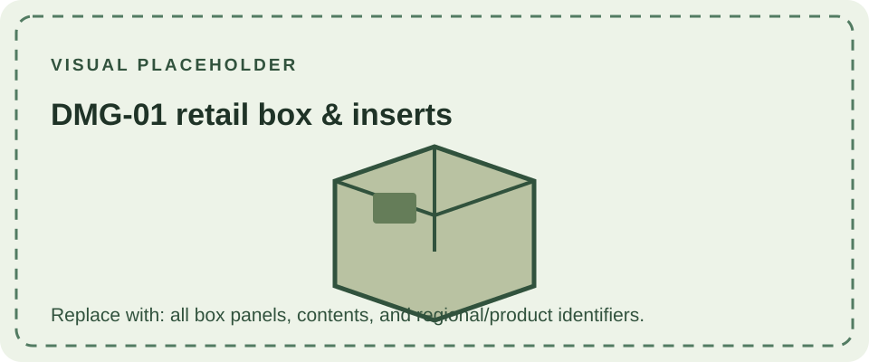

This is an initial inventory of documented DMG-01 retail configurations. The identifiers below are catalogued product or bundle codes where available; `DMG-01 JPN` is a console/model-and-region identifier, not a confirmed box SKU. Included contents are recorded for the photographed example and may differ by print run or market.

| Configuration | Region | Product / bundle code | Documented contents and identifying details | Photo record / provenance |
| --- | --- | --- | --- | --- |
| Original Japanese console set | Japan | `DMG-01 JPN` (model/region record; box code not confirmed) | 1989 Japanese launch configuration. Preserve the box, inserts, Japanese manual, and accessories as one observed set; do not infer a universal pack-in list from one example. | [Photographed collection record](https://www.gameboymuseum.com/dmg-01-collection-list); collector archive identifies the item as its Japanese release. |
| Console-only retail set | UK | `DMG-S-GA-UKV` | Standard DMG-01 sold without a pack-in game; a photographed example is catalogued as the UK console-only version. | [Item record and photographs](https://www.gameboymuseum.com/game-boy-hardware-guide/consoles/dmg-s-ga-ukv/game-boy-console-%28ukv%29). The page identifies its images as photographs of the archive's privately held items. |
| Classic Tetris bundle | USA | `DMG-GBTR-USA-3` | Console, Tetris, and stereo headphones in the documented example. Some US boxes carry an external serial-number / warranty-card label; treat it as an observed authenticity clue, not a rule for every print run. | [Item record and photographs](https://www.gameboymuseum.com/game-boy-hardware-guide/consoles/dmg-gbtr-usa-3/game-boy-classic-tetris-bundle-%28usa%29). |
| Classic Tetris bundle | UK / UKV | `DMG-GBTR-UKV` | Documented regional bundle includes Tetris, a Game Link cable, and stereo headphones with the console. | [Collection overview and photographs](https://www.gameboymuseum.com/dmg-01-collection-list). |
| Super Star Set | Germany / NOE | `DMG-A-GA01-NOE` | Documented bundle pairs the console with *The Legend of Zelda: Link's Awakening* and *Super Mario Land 2*. | [Item record and photographs](https://www.gameboymuseum.com/game-boy-hardware-guide/consoles/dmg-a-ga01-noe/game-boy-console-super-star-set-%28zelda-%26-super-mario-2%29). |

### Photograph and provenance notes

The linked Game Boy Museum records provide photographs of physical collection examples and identify the reported region and product code. The museum states that its images are its own photographs of privately held items and that it is an independent preservation project, not affiliated with Nintendo. The links document examples; they do not establish that every unit in a region shipped with identical inserts or contents.

For new archive photographs, capture all box panels, end labels, barcode and serial stickers, tray and inserts, paperwork, and every accessory. Record who supplied the item or image, where it was held, and whether the photographed contents were verified as original to that box. Do not reproduce third-party images without permission; the image above remains a placeholder pending sourced archive photography.
