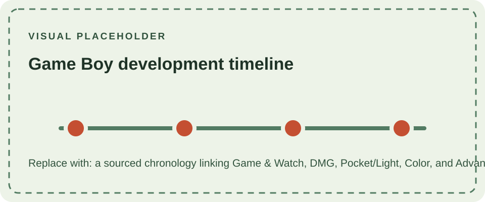

## From Game & Watch to Game Boy

The Game Boy emerged from Nintendo's desire to take its successful handheld gaming concept to the next level. The company's Research & Development 1 division (R&D1), led by Gunpei Yokoi, had already established Nintendo as a major player in portable gaming through the Game & Watch series.

By the early 1980s, however, the limitations of the Game & Watch platform were becoming increasingly apparent. Each unit was built around a single game and used a segmented LCD designed specifically for that title. R&D1 began looking for a way to create a more flexible system that could run multiple games while remaining inexpensive, compact, and suitable for everyday use.

The answer was a **dot-matrix display combined with interchangeable cartridges**. This fundamental change would transform the concept from a collection of dedicated electronic games into a general-purpose handheld console.

## The DMG Project

On June 10, 1987, R&D1 received the go-ahead to develop a successor to Game & Watch with a target price below ¥10,000. The project was internally known as **Dot Matrix Game**, or **DMG**.

The name eventually became part of the product's identity: the original Game Boy was released as the **DMG-01**.

From the beginning, the project was shaped by Gunpei Yokoi's philosophy of *lateral thinking with withered technology*. Rather than pursuing the most powerful hardware available, Nintendo focused on established technologies that could deliver a reliable and affordable product.

This approach created an important debate within the development team. Yokoi initially favored a simple evolution of Game & Watch, while Satoru Okada pushed for a more capable machine with interchangeable cartridges. The latter approach ultimately prevailed, turning the DMG into a true cartridge-based game system.

## Designing the Hardware

Hardware decisions were driven by a balance between cost, reliability, battery life, and functionality.

Nintendo considered using a Ricoh processor similar to the one found in the NES, but ultimately selected a Sharp processor. One consequence of this decision was the availability of communication capabilities that could be used to connect two consoles.

Satoru Okada recognized the potential of this feature and developed the technology that became the **Game Link Cable**. What initially appeared to be a relatively simple hardware feature would later become an important part of the Game Boy ecosystem, enabling multiplayer gaming and data exchange between consoles.

The DMG also retained another important element of Nintendo's handheld heritage: the **D-pad**. Originally developed by Yokoi for compact gaming devices, it provided precise directional control without requiring the space or mechanical complexity of a joystick.

## The Display Problem

The display became one of the most difficult challenges during development.

Nintendo evaluated several LCD manufacturers and technologies. Early attempts with conventional dot-matrix displays suffered from severe ghosting and poor image quality, raising doubts about whether the project could succeed.

Color displays were considered, but they conflicted with the project's fundamental priorities. They were considerably more expensive and consumed more power. Nintendo therefore chose a monochrome display without a backlight, accepting reduced visual capability in exchange for lower cost and significantly better battery life.

Sharp eventually became Nintendo's display partner, but development problems nearly brought the entire project to an end.

## Almost Cancelled

In 1988, an early prototype was presented to Nintendo president Hiroshi Yamauchi. The display was considered inadequate, particularly because of its poor visibility, and the project was temporarily cancelled.

Most of the R&D1 team was reassigned. Gunpei Yokoi, however, continued to pursue a solution.

The breakthrough came through the discovery of a **Super-Twisted Nematic (STN)** LCD technology being developed by Sharp. Although the display had its own limitations, including a characteristic green tint and relatively low contrast, it offered a substantially improved viewing angle and made the concept viable.

A prototype using the new display was eventually presented again to Yamauchi. Despite the previous cancellation, the improved screen was sufficient for the project to receive approval for commercial release.

The decision came with a cost. The more sophisticated display increased manufacturing expenses, forcing Nintendo to reconsider the original pricing target. The final Japanese retail price was set at **¥12,500**, rather than the intended ¥10,000.

## Preparing for Launch

Nintendo officially announced the Game Boy on January 17, 1989.

The Japanese launch followed on April 21, 1989. The initial production run of 300,000 units sold out within two weeks, demonstrating that the concept had found an audience despite its deliberately modest specifications.

The North American launch took place on July 31, 1989. Nintendo supported the release with a major marketing campaign and positioned the Game Boy as a portable entertainment system rather than simply another electronic toy.

One of the most important decisions surrounding the international launch was the inclusion of **Tetris**.

Rather than limiting the system's appeal to the traditional young gaming audience, Tetris provided a game that was accessible to a much broader range of players. Nintendo bundled it with the Game Boy in North America and other markets, helping establish the handheld as a mainstream consumer product.

## A Different Definition of Portable Power

The DMG-01 was technically modest compared with some of its contemporary competitors. Its monochrome screen, relatively simple processor, and lack of backlighting appeared conservative beside more technologically ambitious handhelds.

That was precisely the point.

Nintendo had optimized the system around a different set of priorities: **low cost, durability, long battery life, and a large software library**.

The result was a platform capable of surviving years of use while remaining affordable enough to reach a very large audience.

The Game Boy's success was subsequently reinforced by its extensive software library and by the arrival of major franchises, most notably Pokémon in the late 1990s.

The original design was later refined without abandoning its cartridge-based foundation. The [Game Boy Pocket](/consoles/game-boy-pocket/) reduced the size and changed the battery format; the Japan-only [Game Boy Light](/consoles/game-boy-light/) added an electroluminescent screen panel. The [Game Boy Color](/consoles/game-boy-color/) introduced native color and revised hardware while continuing to play the earlier monochrome library.

Nintendo's later [Game Boy Advance](/consoles/game-boy-advance/) marked a new 32-bit generation, followed by the folding [Advance SP](/consoles/game-boy-advance-sp/) and compact [Micro](/consoles/game-boy-micro/). These systems extended the family but introduced distinct hardware and compatibility boundaries.

## Legacy

Nintendo continued supporting the original Game Boy platform even after the introduction of the Game Boy Color in 1998. Later hardware, including the Game Boy Advance, maintained compatibility with the original Game Boy software library.

The original DMG-01 therefore represents more than the first version of a successful handheld console. It established a design philosophy that influenced Nintendo's portable hardware for years:

**simple technology, carefully chosen, can become remarkably powerful when the system is designed around the experience rather than the specification.**
