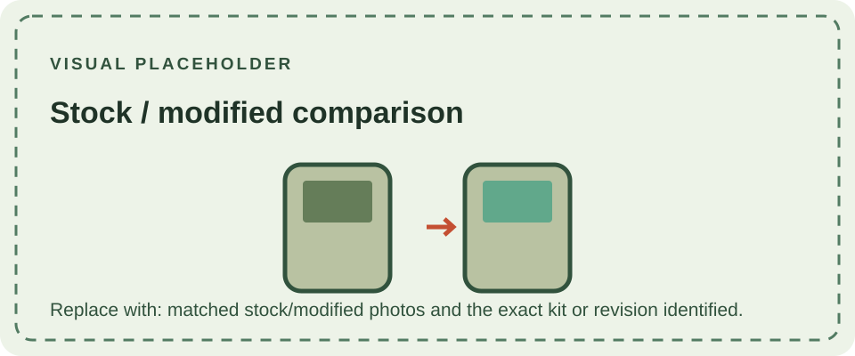

The DMG-01 is frequently modified to improve display visibility, audio output, or power convenience. Common projects include replacement LCD assemblies, audio line outputs, rechargeable battery conversions, and cosmetic shell changes. These are aftermarket alterations, not factory DMG-01 variants.

Each modification can change power consumption, internal clearance, repairability, or the appearance of the original hardware. Screen replacements may require trimming or adhesives and do not reproduce the original reflective LCD. Rechargeable cells need an appropriate charging and protection circuit; a USB connector alone does not make a safe charging design. Audio modifications can introduce noise or alter the original signal path.

Before modifying a console, document its original board revisions and test its existing functions. Use instructions written for the exact kit and board revision, and distinguish reversible installation from cutting, drilling, or soldering. This archive records the stock console in the [DMG-01 overview](/consoles/dmg-01/overview/), [physical design section](/consoles/dmg-01/physical-design/shell-housing/overview/), and [PCB revision pages](/consoles/dmg-01/pcbs-revisions/dmg-cpu-01/).
