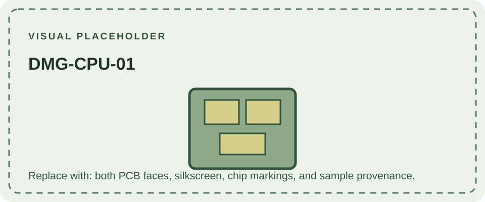

DMG-CPU-01 is the earliest numbered CPU-board marking in the commonly documented DMG-01 sequence. The board marking identifies the main CPU PCB revision, not necessarily the revisions of the LCD, power-converter, and headphone-jack boards installed in the same console.

Published comparative references describe DMG-CPU-01 through -06 as broadly similar, but do not establish a complete, authoritative change log for every revision. Do not infer a specific manufacturing date, region, or behavior from this number alone. Record the board silkscreen, chip markings, date codes, and the other board identifiers when documenting a unit.

Later revisions are covered in [DMG-CPU-02](/consoles/dmg-01/pcbs-revisions/dmg-cpu-02/) through [DMG-CPU-08](/consoles/dmg-01/pcbs-revisions/dmg-cpu-08/). See the [DMG-01 overview](/consoles/dmg-01/overview/) and the [Game Boy hardware database](https://gbhwdb.gekkio.fi/consoles/dmg/) for photographed examples.
