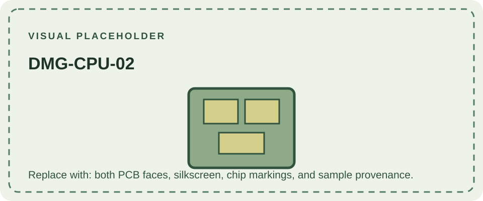

DMG-CPU-02 is a numbered revision of the DMG-01's main CPU board. The number is printed on the PCB and is most reliably read directly from the board. Console serials and exterior colors are not substitutes for this marking.

Available community comparisons group DMG-CPU-01 to -06 as broadly similar. A comprehensive, verified per-revision list of component substitutions and functional changes is not available in the references used here, so this page does not assign an unsupported change to -02. A complete console can also combine boards with different revision markings.

Compare [DMG-CPU-01](/consoles/dmg-01/pcbs-revisions/dmg-cpu-01/) and [DMG-CPU-03](/consoles/dmg-01/pcbs-revisions/dmg-cpu-03/). Photographic examples are indexed by the [Game Boy hardware database](https://gbhwdb.gekkio.fi/consoles/dmg/).
