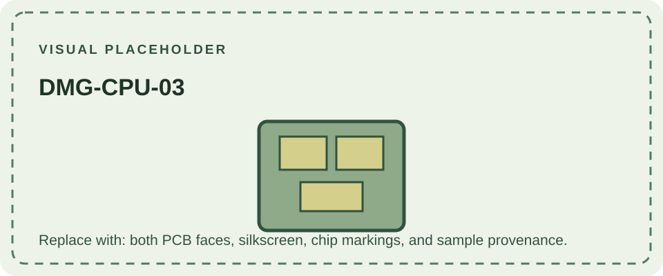

DMG-CPU-03 denotes a revision of the DMG-01 main CPU PCB. It should be distinguished from revisions of the console's LCD and auxiliary boards, which have their own markings. A board revision is evidence about that circuit board; by itself it does not date every part of the assembled console.

Public references generally group DMG-CPU-01 through -06 as similar designs and do not provide a reliable change-by-change engineering history for -03. The archive therefore records the identifier without attributing undocumented component or software differences to it. When inspecting hardware, photograph both PCB faces and note chip labels and date codes.

See [DMG-CPU-02](/consoles/dmg-01/pcbs-revisions/dmg-cpu-02/) and [DMG-CPU-04](/consoles/dmg-01/pcbs-revisions/dmg-cpu-04/) for neighboring identifiers, and the [hardware database](https://gbhwdb.gekkio.fi/consoles/dmg/) for submitted specimens.
