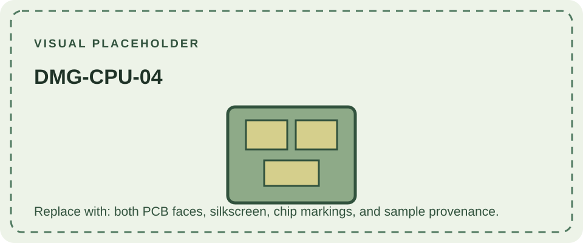

DMG-CPU-04 is one of the numbered main-board revisions documented for the original Game Boy. Its silkscreen is the direct identifier. The board is only one part of the DMG-01's multi-board assembly, so a revision number should be reported alongside the LCD, power, and jack-board markings when precision matters.

References that survey the DMG family describe revisions -01 to -06 as broadly similar, but do not supply a complete, source-backed engineering delta for each number. No specific component, date, or regional behavior is assigned here without that evidence. Board samples and date codes can help researchers compare production, but a small submitted sample is not proof of a universal sequence.

Continue to [DMG-CPU-05](/consoles/dmg-01/pcbs-revisions/dmg-cpu-05/) or review the [hardware database](https://gbhwdb.gekkio.fi/consoles/dmg/) alongside the [DMG-01 overview](/consoles/dmg-01/overview/).
