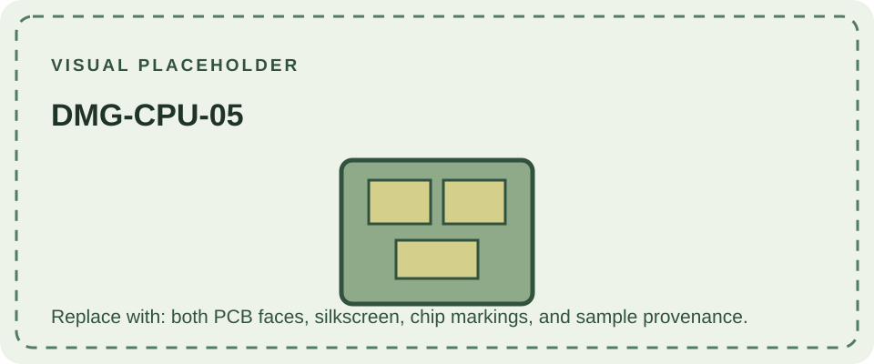

DMG-CPU-05 is a marked revision of the DMG-01 CPU board. As with the other numbered boards, the marking describes the PCB assembly and should not be treated as the console's complete model name or a stand-alone production date.

Comparative sources place -05 within the broadly similar -01 to -06 group. A per-revision engineering change record is not established by the sources consulted for this page, so exact component differences remain undocumented here. Researchers should compare board photographs, component designators, chip markings, and date codes rather than relying on an unsourced list.

See [DMG-CPU-04](/consoles/dmg-01/pcbs-revisions/dmg-cpu-04/) and [DMG-CPU-06](/consoles/dmg-01/pcbs-revisions/dmg-cpu-06/). Sample boards can be reviewed in the [Game Boy hardware database](https://gbhwdb.gekkio.fi/consoles/dmg/).
