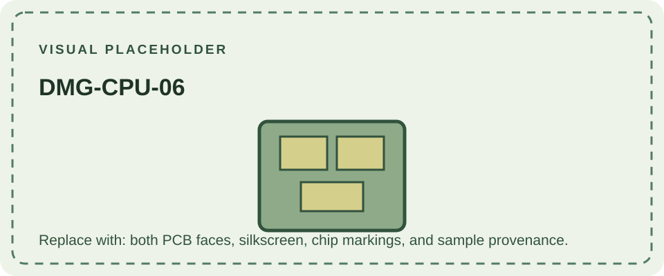

DMG-CPU-06 is the last numbered CPU-board revision before the cost-reduced -07 and -08 boards in commonly documented DMG-01 hardware surveys. The number appears on the main PCB. A console can still contain other boards from different revision groups, so record each assembly separately.

The -01 to -06 boards are generally described as similar in broad architecture. Public references do not provide enough authoritative detail to claim a complete list of changes specific to -06. Identify individual units from their markings and component population; do not assume all units with the same main-board number share every secondary-board revision.

The later [DMG-CPU-07](/consoles/dmg-01/pcbs-revisions/dmg-cpu-07/) and [DMG-CPU-08](/consoles/dmg-01/pcbs-revisions/dmg-cpu-08/) use a visibly different chip packaging approach. Compare samples in the [hardware database](https://gbhwdb.gekkio.fi/consoles/dmg/).
