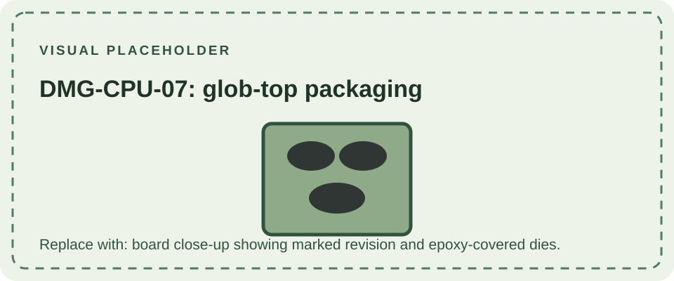

DMG-CPU-07 is a later cost-reduced revision of the original Game Boy main board. Unlike earlier boards with separately packaged processor and memory chips, -07 is documented with bare dies mounted on the PCB and protected by epoxy encapsulation, commonly called glob-top packaging. This is a visible construction difference, not a new console generation.

The board retains the DMG-01 platform and original Game Boy cartridge compatibility. The epoxy-covered dies are not ordinary removable packaged ICs, which changes repair and component-replacement options. Do not use the glob-top appearance alone to identify a board: confirm the silkscreen marking and photograph the entire assembly.

Compare with the earlier [DMG-CPU-06](/consoles/dmg-01/pcbs-revisions/dmg-cpu-06/) and later [DMG-CPU-08](/consoles/dmg-01/pcbs-revisions/dmg-cpu-08/). The [Game Boy hardware database](https://gbhwdb.gekkio.fi/consoles/dmg/) provides photographs of submitted revisions; [ConsoleMods' model comparison](https://consolemods.org/wiki/Game_Boy%3AModel_Differences) summarizes the broad distinction between early and cost-reduced boards.
