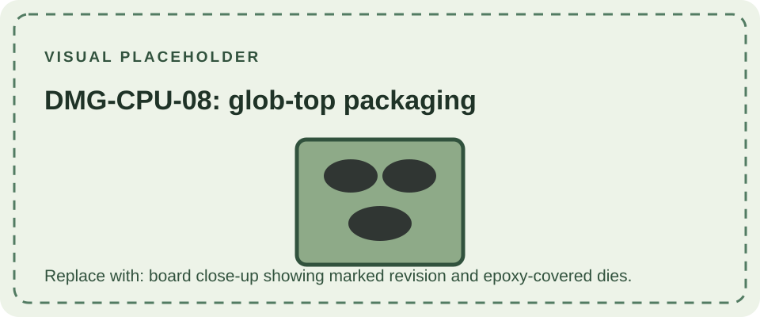

DMG-CPU-08 is a late DMG-01 main-board revision. Like -07, it is documented with bare processor and memory dies mounted directly on the PCB under protective epoxy glob tops, a cost-reduced alternative to separately packaged chips. The DMG-CPU-08 marking, rather than shell color or serial alone, identifies the board.

The console remains an original monochrome Game Boy and retains the DMG platform's software and cartridge behavior. The packaging affects component-level repair because the silicon dies are not socketed or individually replaceable as conventional IC packages. Other parts of the assembled console may still have different revision markings.

See [DMG-CPU-07](/consoles/dmg-01/pcbs-revisions/dmg-cpu-07/) for the related construction, [DMG-CPU-06](/consoles/dmg-01/pcbs-revisions/dmg-cpu-06/) for the preceding numbered group, and the [hardware database](https://gbhwdb.gekkio.fi/consoles/dmg/) for photographed examples.
