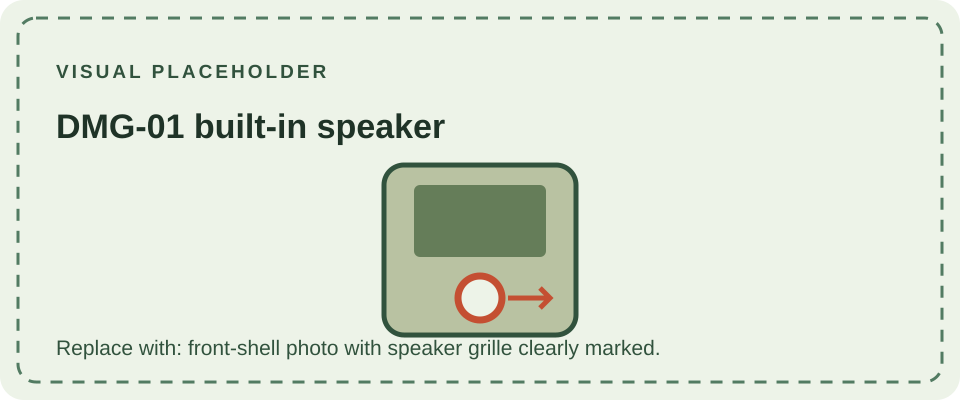
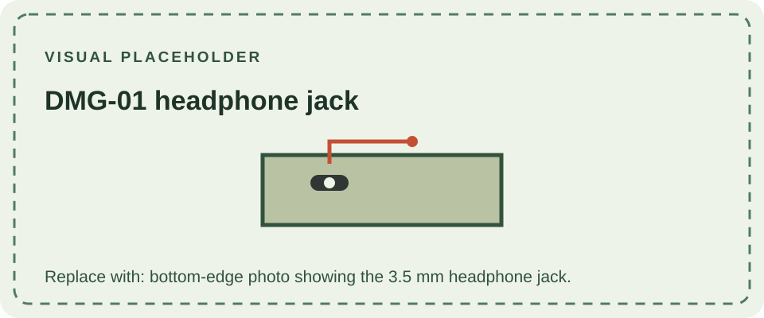

The DMG-01 has a built-in mono speaker and a 3.5 mm headphone jack that provides stereo audio. The jack is on the bottom edge of the console; the speaker sits behind the perforated grille on the front shell. Inserting a headphone plug switches the built-in speaker off. The jack's switch contacts can affect speaker output if they become dirty or fail to reconnect.

The Nintendo [user guide identifies the headphone jack and speaker](https://device.report/m/6151e4f8824cea16a04242437c3473e1138be7691f7c0ceca52f06adf6fc1233.pdf); the original Game Boy's headphone output is stereo while its built-in speaker is mono. For the board assembly and jack PCB, see [PCBs & Revisions](/consoles/dmg-01/pcbs-revisions/overview/).
