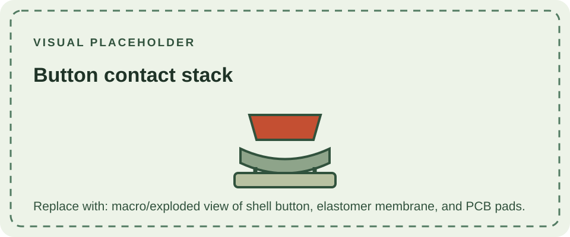

The DMG-01 has a cross-shaped directional pad, two round action buttons marked A and B, and separate Start and Select buttons. Each button transfers force through the shell to a conductive elastomer contact. Pressing the contact bridges exposed pads on the control circuitry, registering an input without a conventional metal switch for each key.

The D-pad and A/B buttons sit in molded openings in the front shell; the smaller Start and Select controls are positioned below them. Dust, residue, worn contacts, damaged membranes, or cracked shell supports can cause inconsistent input. Cleaning and repair should preserve the carbon contact surfaces and avoid abrasive treatment.

The [materials page](/consoles/dmg-01/physical-design/materials/) describes the enclosure at a high level. The button layout is one of the identifying features noted in the [DMG-01 overview](/consoles/dmg-01/overview/).
