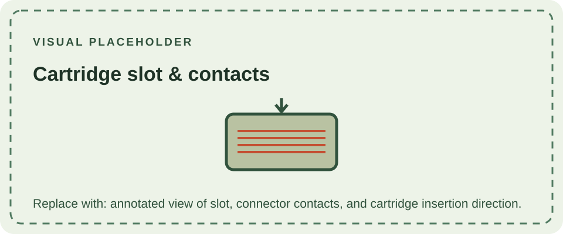

The DMG-01 uses a top-loading slot for Game Boy cartridges. Insertion seats the cartridge's edge contacts against the console's connector; the cartridge supplies the game ROM and may contain additional memory, a memory bank controller, or save-memory circuitry. The console reads the cartridge header during startup and uses it to identify expected software and hardware features.

Original Game Boy cartridges are supported by the DMG-01. Later Game Boy Color cartridges marked as exclusive to the Color system are not compatible, while dual-mode releases may contain software that selects an appropriate experience on older hardware. Cartridge compatibility depends on the game and its mapper, not simply the physical fit.

Keep the slot free of debris and avoid forcing a cartridge. For the data-side explanation, consult the [Game Boy technical reference](/reference/example/); for the battery-backed save system used by some cartridges, see its section on [cartridge memory](/reference/example/).
