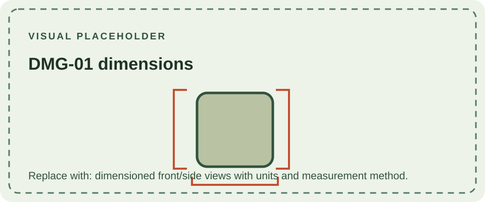

Nintendo lists the Game Boy at **90 × 148 × 32 mm (width × height × depth)**. This is the published overall size of the DMG-01 body; a cartridge is not included. Individual surviving shells, replacement parts, and measurement methods can produce small differences when measured directly.

The DMG-01 is a comparatively large, upright handheld designed around four AA cells, a 2.6-inch monochrome display, and a full-size cartridge slot. Its volume provides room for the battery compartment and separate internal boards. The later [Game Boy Pocket](/consoles/game-boy-pocket/) reduced the enclosure and changed to AAA cells; it is not simply a smaller DMG shell.

The published figure is a product dimension, not a mold drawing or a tolerance specification. For restoration, compare a known original shell and use the relevant service documentation rather than treating the rounded figure as a manufacturing measurement.

## Source

- [Nintendo UK: Game Boy technical details](https://www.nintendo.com/en-gb/Hardware/Nintendo-History/Game-Boy/Game-Boy-627031.html) — lists the 90 × 148 × 32 mm size.
