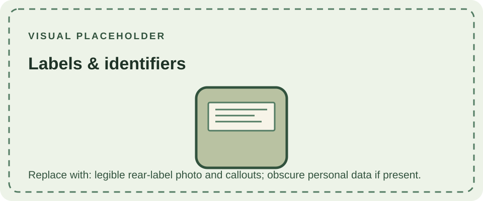

The rear label and molded case details can identify a unit's model family, market, regulatory information, and serial number. The cartridge door, lens, buttons, and shell finish provide additional observations, but these parts can be replaced independently. No single external feature proves that a console retains its original factory configuration.

When recording a console, photograph the complete front and rear, capture labels legibly, and note the serial and regional wording exactly as printed. Record shell color separately from the model code. To identify the motherboard, inspect its own silkscreen marking; do not infer a specific CPU-board revision from the serial number or shell color alone.

For shell variants, see [Basic Colors](/consoles/dmg-01/physical-design/shell-housing/basic-colors/) and [Limited Editions](/consoles/dmg-01/physical-design/shell-housing/limited-editions/). Internal board identifiers are discussed in [PCBs & Revisions](/consoles/dmg-01/pcbs-revisions/dmg-cpu-01/).
