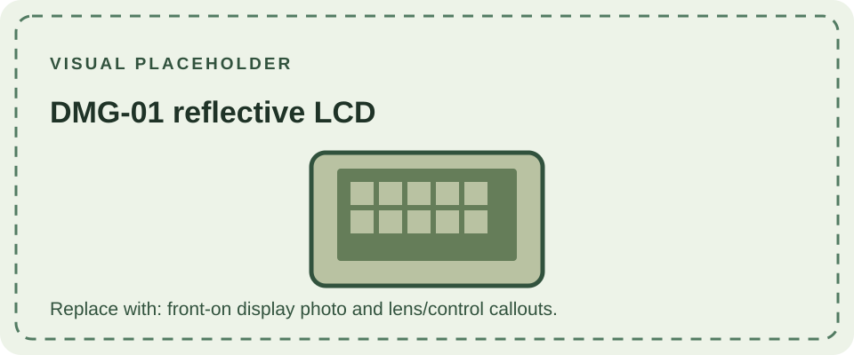

The DMG-01 uses a reflective dot-matrix LCD with a resolution of **160 × 144 pixels**. It displays four monochrome shades and has no built-in backlight, so it relies on ambient light. The front contrast wheel adjusts the display's visible contrast. [Nintendo's Game Boy programming manual](https://files.nekoblog.org/uploads/pdf/39999184-GameBoy-Programming-Manual.pdf) documents the display resolution and four shades.

The screen assembly includes the LCD panel and its visible front lens, while the display circuitry is mounted on the LCD board. Their construction and board revisions can differ between units. Document a specific console's board markings and observed display condition rather than assuming every DMG has identical components.

Slow pixel response can produce visible ghosting during motion, and age or damage may cause missing rows or columns, uneven contrast, or other image defects. Record these as observations; symptoms can also come from connections, adjustment controls, or the LCD board. The [DMG board revision pages](/consoles/dmg-01/pcbs-revisions/dmg-cpu-01/) provide a place to compare board identifiers.
