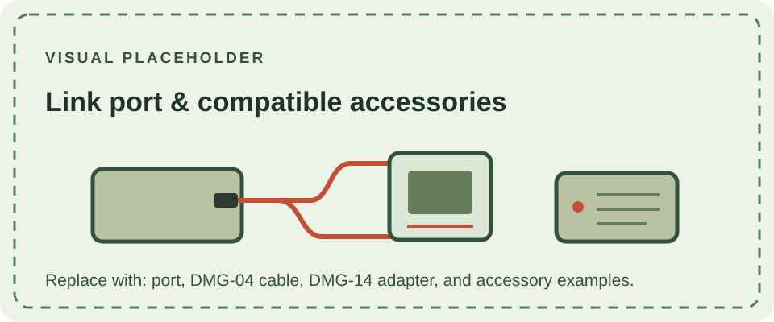

The covered **EXT. port** on the DMG-01's right side is its serial link connection. With a compatible cable and software, it lets Game Boy systems exchange data for multiplayer play or accessory functions. The DMG uses the larger original connector; Pocket, Light, Color, and later systems use different connector styles, so a cable that fits one model may not connect directly to another. Nintendo's [link-cable adapter guide](https://www.nintendo.com/en-gb/Support/Legacy-system/Link-cable-adapter-619614.html) explains the large-to-small connector adapter and notes that the game must support link play.

## Cables and adapters

| Accessory | Use with the DMG-01 | Compatibility notes |
| --- | --- | --- |
| **Game Link Cable DMG-04 / DMG-04A** | Connects the original DMG-style ports on two systems. | Use with a title that supports link play. Nintendo's accessory list identifies the DMG-04A as the original Game Boy cable. |
| **Universal Game Link Adapter DMG-14** | Adapts a newer small-connector cable to the DMG's larger EXT port. | Used with a compatible Universal Game Link Cable to connect an original Game Boy to later models or accessories. |
| **Four Player Adapter DMG-07** | Adds a hub for multiplayer with up to four Game Boy systems. | Requires a game that specifically supports the adapter; ordinary two-player link support alone is not enough. |

Nintendo's official [Universal Game Link Cable Set guide](https://www.nintendo.com/en-gb/Support/Legacy-system/Universal-Game-Link-Cable-Set-619604.html) describes the DMG-14 adapter and lists the Game Boy Printer among supported connections. Nintendo Japan's [accessory compatibility chart](https://www.nintendo.co.jp/n08/hardware/micro/equipment/index.html) also lists the DMG-04A cable and DMG-07 adapter for the original Game Boy, and notes when a conversion adapter is required.

## Peripherals and software support

- **Game Boy Printer (MGB-007):** prints images or other output from compatible Game Paks. Connecting it to a DMG requires the appropriate Universal Game Link cable and the DMG-14 connector adapter. The game must include printer support; the port and printer alone do not add that feature.
- **Four-player games:** the DMG-07 supports titles written for its four-system hub. The hardware reference [Dan Docs](https://shonumi.github.io/dandocs.html) documents supported examples such as *F-1 Race*, *Wave Race*, and *Yoshi's Cookie*. Treat compatibility as title-specific and verify the game's manual or packaging.
- **Game Boy Camera (MGB-006):** this is a cartridge accessory that inserts into the Game Pak slot, not into the EXT port. It can use the link connection to send compatible images to a Game Boy Printer.

When linking two systems, use the cable type and connection setup specified by the game's manual. Both systems need compatible software modes, and cross-generation connections may require the appropriate adapter. See [Power & Connections](/consoles/dmg-01/physical-design/power-connections/) for the port's location and [Game Boy Cartridges](/cartridges/game-boy-cartridges/) for cartridge compatibility.
