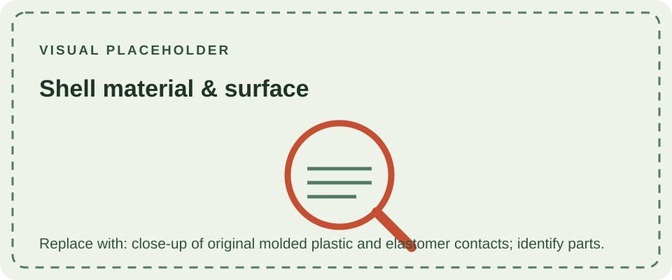

The DMG-01 housing is injection-molded plastic, with separate pieces for the front shell, rear shell, and battery cover. The display is protected by a fitted transparent lens, and the controls use molded buttons operating conductive elastomer contacts against the control board. This construction keeps the handheld light and allows the enclosure and electrical controls to be assembled as separate parts.

Exact polymer grades and resin formulations are not specified consistently in public Nintendo documentation. Color, aging, surface texture, and repair history can also change how a shell looks, so this page avoids assigning a specific resin by appearance alone. Replacement shells may use different plastics and tolerances from original parts.

Related details are covered in [buttons and membranes](/consoles/dmg-01/physical-design/buttons-membranes/), [dimensions](/consoles/dmg-01/physical-design/dimensions/), and the [shell and housing overview](/consoles/dmg-01/physical-design/shell-housing/overview/).
