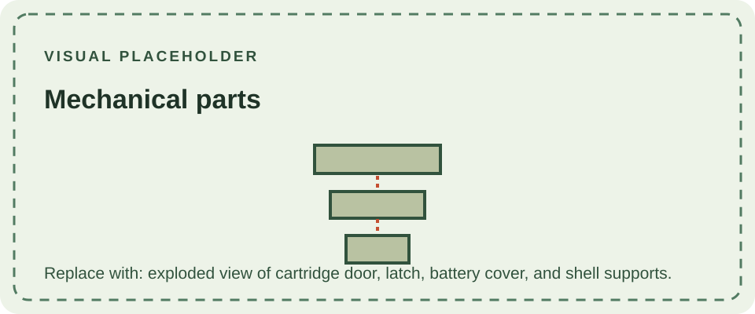

The DMG-01's mechanical construction includes the two shell halves, battery cover and latch, cartridge door, control buttons, and internal supports that locate the display and circuit boards. These parts are mostly passive: the cartridge door and battery-cover latch retain or guide components, while the buttons transfer a press to the electrical contacts.

The rear cartridge door is spring-loaded and closes over an inserted cartridge. The battery cover slides into molded rails and is retained by a small screw. The case has internal posts and ribs that maintain spacing between the shell and electronic assemblies; damage to those features can lead to loose controls, creaking, or poor alignment.

Material and assembly details are in [Materials](/consoles/dmg-01/physical-design/materials/) and [Screws & Fasteners](/consoles/dmg-01/physical-design/screws-fasteners/). Input parts are covered under [Buttons & Membranes](/consoles/dmg-01/physical-design/buttons-membranes/).
