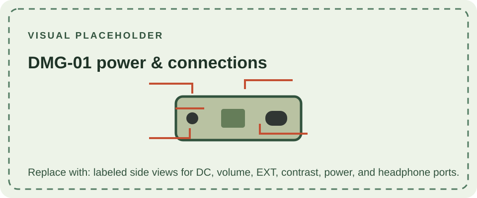

The DMG-01 has four main user-facing connection areas: battery power and an external DC input; a headphone jack; a serial Game Link port; and the cartridge slot. The volume and contrast wheels and the power switch sit alongside these interfaces. Their locations and labels are useful when identifying a unit or comparing regional variants.

On the left side are the **volume control** and **external DC input**. The right side carries the **contrast control** and the covered **EXT. serial port**, used with compatible link cables and peripherals. The **headphone jack** is on the bottom edge, and the cartridge slot is at the top. The [Nintendo user guide](https://device.report/m/6151e4f8824cea16a04242437c3473e1138be7691f7c0ceca52f06adf6fc1233.pdf) labels the external power jack, contrast adjustment, and link connection.

The console can run from four AA batteries or a suitable external DC supply. Verify an adapter's electrical rating and polarity before use; a plug that fits does not by itself establish compatibility. See [Battery Compartment](/consoles/battery/) for battery installation, polarity, and contact details. For the serial port, cables, adapters, and supported peripherals, see [Link Port & Peripherals](/consoles/dmg-01/physical-design/link-port-peripherals/). Audio behavior is covered under [Speaker & Headphone Jack](/consoles/dmg-01/physical-design/audio-output/); cartridge fit and compatibility are covered under [Cartridge Slot](/consoles/dmg-01/physical-design/cartridge-slot/).
