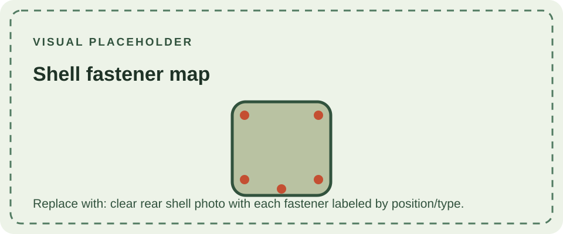

The two shell halves are held together with recessed screws engaging molded posts. The battery cover has its own small retaining screw and a sliding latch; it can be removed for battery access without opening the console. Screw-head styles and production details may vary across units and replacement shells.

Use the correct driver for the screw head and keep each fastener with its original location during service. Forcing a mismatched bit can damage the head, while overtightening can crack a post or strip the plastic. This page intentionally avoids asserting a universal screw count or length because revisions, repairs, and shell replacements can change the hardware found in an individual unit.

The case construction is described in the [shell overview](/consoles/dmg-01/physical-design/shell-housing/overview/); see [mechanical parts](/consoles/dmg-01/physical-design/mechanical-parts/) for the battery latch and other moving features.
