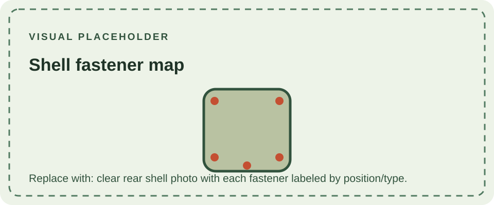

The DMG-01 uses different screw drives for the outer shell and the internal boards. The six screws around the rear shell are usually **Y-type tri-point** screws, commonly sold as *tri-wing*; the correct driver is **Y1**. Some early DMG units instead have **Phillips-style cross-head screws** in these same six positions. Check the head on the individual console before choosing a driver: production variations and replacement shells exist. [iFixit identifies the standard case screws as Y1 tri-point](https://www.ifixit.com/Teardown/Nintendo%2BGame%2BBoy%2BTeardown/122657), while [Handheld Legend documents both Y1 and Phillips variants](https://docs.handheldlegend.com/s/portal/doc/disassembly-guide-QoL1zoC3Zg).

The screws securing the internal boards are **cross-head screws** (often called Phillips). These are separate from the six outer-shell fasteners; do not use a Y-type driver on them. Phillips and JIS profiles can look similar, so use a well-fitting driver and stop if it slips. The battery cover also has a small retaining fastener and sliding latch.

Use the correct driver for the screw head and keep each fastener with its original location during service. Forcing a mismatched bit can damage the head, while overtightening can crack a post or strip the plastic. Screw lengths and replacement hardware can vary, so inspect the unit and retain each screw in its original position.

The case construction is described in the [shell overview](/consoles/dmg-01/physical-design/shell-housing/overview/); see [mechanical parts](/consoles/dmg-01/physical-design/mechanical-parts/) for the battery latch and other moving features.
