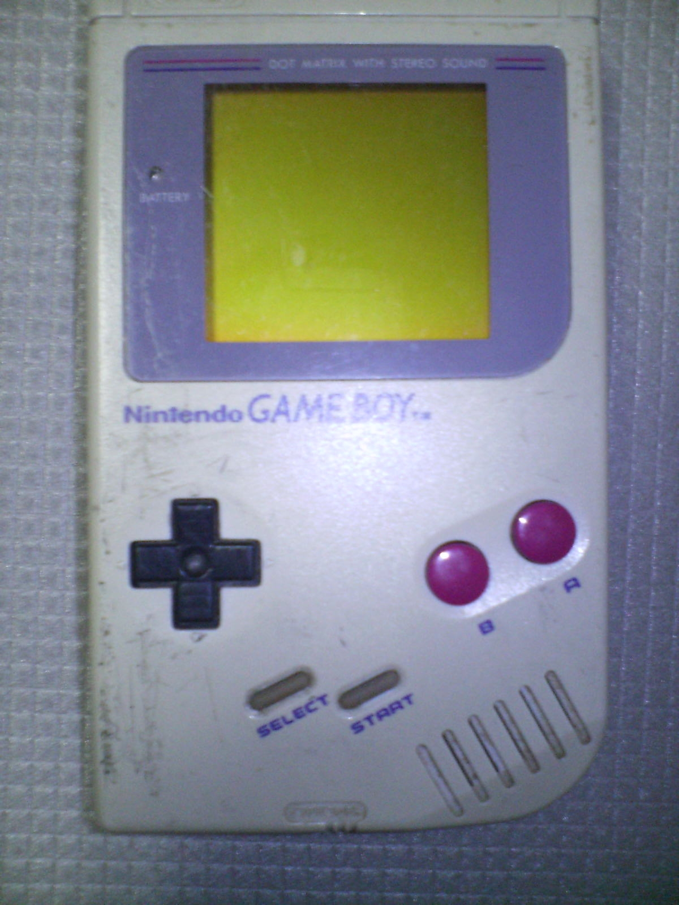
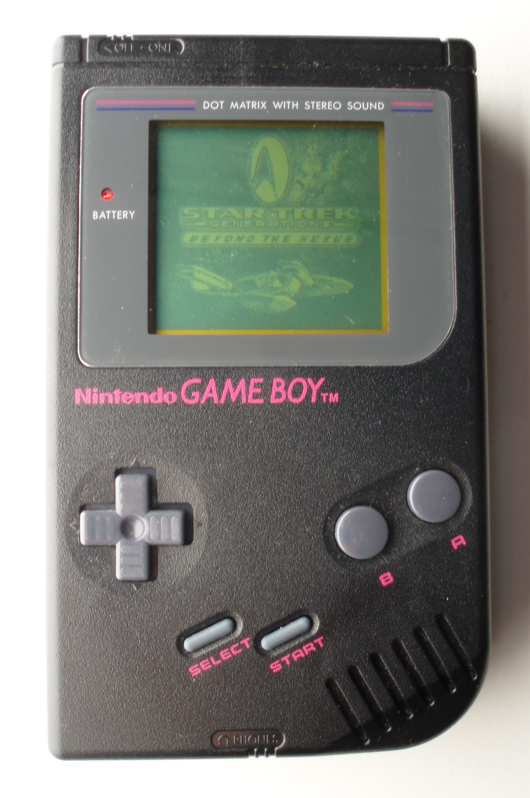
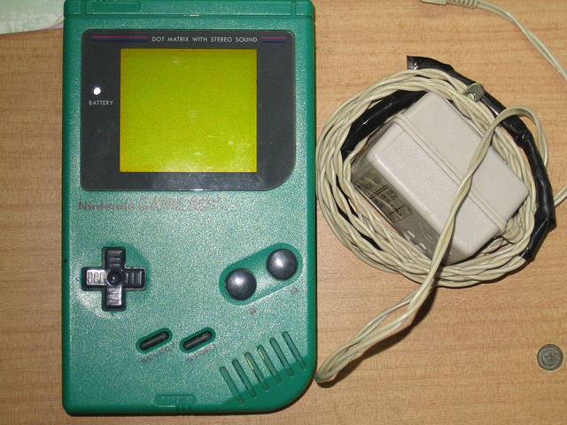
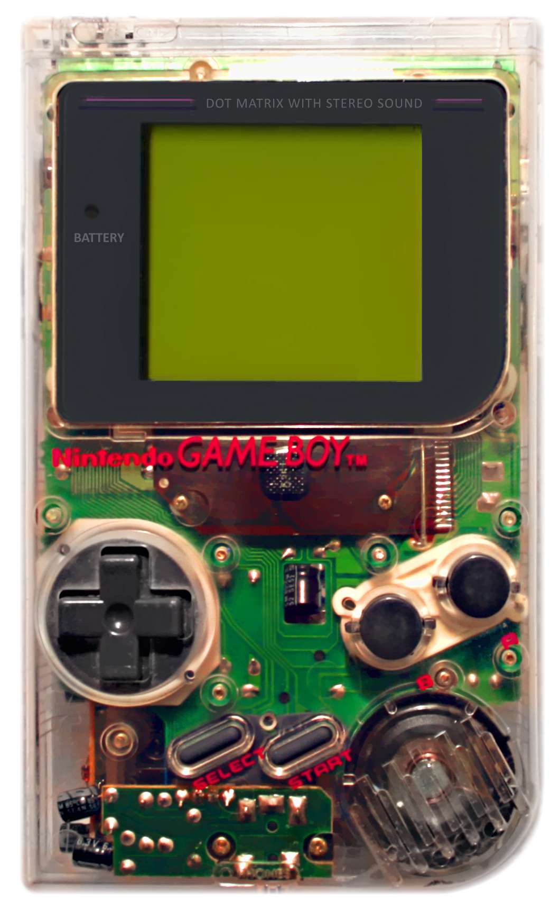

## Original finish

The original DMG-01 was introduced with a light gray shell. Its familiar two-tone appearance comes from the gray housing paired with darker controls and trim. This is the finish most closely associated with the Game Boy's 1989 launch.

## Colored releases

Nintendo later released DMG-01 consoles with colored housings. In 1995, the colored models were promoted in North America as the **Play It Loud!** range and in Japan as **Game Boy Bros.** The range included red, green, black, yellow, and transparent shells. Blue and white models were also released, with availability varying by region.

These color variants retained the DMG-01 hardware; the shell color identifies the exterior variant rather than a different console model. Specially branded or promotional units are covered separately under **Limited Editions**.

### Color examples

| Original gray | Black Play It Loud! |
| --- | --- |
|  *Photo: PiaCarrot, Wikimedia Commons; CC BY-SA.* |  *Photo: Morn the Gorn, Wikimedia Commons; CC BY-SA.* |

| Green Play It Loud! | Transparent Play It Loud! |
| --- | --- |
|  *Photo: 蜜蜂, Wikimedia Commons; CC BY-SA 3.0.* |  *Photo: Tommo89, cropped by Evan-Amos, Wikimedia Commons; CC BY-SA 3.0.* |

These photographs show selected examples; the catalogued color range also includes red, yellow, blue, and white variants.

Color names and regional availability can vary between packaging, markets, and collector references. When identifying an individual console, record its region, product labels, and shell details instead of relying on color alone.

## References

- [Game Boy Museum: DMG-01 collection](https://www.gameboymuseum.com/dmg-01-collection-list)
- [ConsoleMods Wiki: Game Boy model differences](https://consolemods.org/wiki/Game_Boy%3AGame_Boy_Model_Differences)
