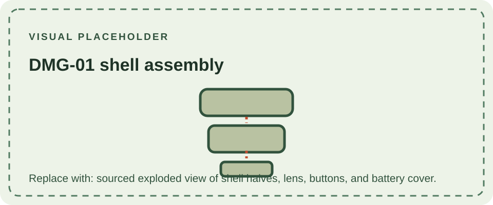

The DMG-01 enclosure is a two-piece molded housing that carries the display lens, directional pad, action buttons, speaker openings, controls, ports, and removable battery cover. Internal posts and screw bosses align the housing with the display assembly and several circuit boards. The shell is part of the console's mechanical design, but it is not a reliable guide to the exact motherboard revision inside.

Nintendo released the DMG-01 in its familiar light-gray finish and later in a range of colored housings. Read about [standard colors](/consoles/dmg-01/physical-design/shell-housing/basic-colors/), the regional [Play It Loud! / Game Boy Bros. series](/consoles/dmg-01/physical-design/shell-housing/play-it-loud/), and [branded or promotional editions](/consoles/dmg-01/physical-design/shell-housing/limited-editions/).

For identification and restoration, record the front and rear shell, labels, serial markings, screw types, and any evidence of replacement parts. The archive treats shell color and branding separately from board revisions; consult the [DMG-01 overview](/consoles/dmg-01/overview/) and [PCB revision pages](/consoles/dmg-01/pcbs-revisions/dmg-cpu-01/) for internal hardware.
