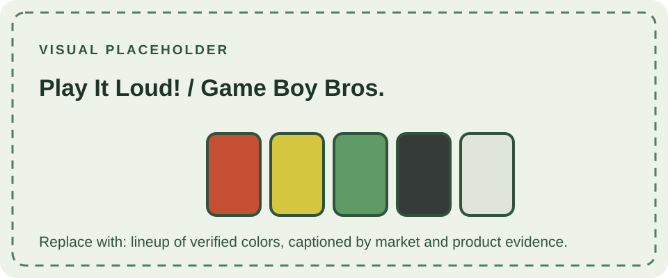

## The colored DMG-01 releases

Nintendo introduced colored versions of the original Game Boy in Japan as **Game Boy Bros.** on November 21, 1994. In 1995, the colored systems were promoted in North America and Europe under the **Play It Loud!** campaign. These releases gave the established DMG-01 a new visual identity while retaining the same core hardware and game compatibility. Nintendo's history records the 1995 introduction of Game Boy systems with color casings.

The Japanese name refers to that market's colored DMG-01 lineup; it is not a separate console model. The timing, campaign name, and available finishes differed by market, so surviving consoles and packaging should be documented with their region and product markings.

## Game Boy Bros. in Japan

The Japanese **Game Boy Bros.** lineup appeared in six shell finishes: red, yellow, green, white, black, and clear (transparent). Japanese product listings date the release to November 21, 1994. These colored units kept the original Game Boy's dimensions and functionality; the change was the exterior finish.

The Bros. colors should not be assumed to describe every Play It Loud! market variant. For example, blue is commonly documented in the European Play It Loud! range, while the Japanese Bros. listings document the six colors above. Regional availability and naming can differ across catalogues and collector references.

## Colors and regional availability

The commonly documented colors are:

| Finish | Commonly documented name | Notes |
| --- | --- | --- |
| Red | Radiant Red | Released in multiple markets. |
| Green | Gorgeous Green | Released in multiple markets. |
| Yellow | Vibrant Yellow | Released in multiple markets. |
| Black | Deep Black | Released in multiple markets. |
| Transparent | High Tech Transparent | Clear shell reveals the internal components. |
| Blue | Cool Blue | Commonly documented as a European Play It Loud! variant. |
| White | Traditional White | Japanese Bros. and select European releases are documented. |

The descriptive color names are widely used by collectors and references; Nintendo's general history page describes the systems as having color casings without listing these names. Blue and white availability is especially market-dependent, so avoid treating a single region's lineup as universal.

## Identifying a console

Color identifies the shell finish, not a separate hardware revision. The colored systems remain DMG-01 consoles. When cataloguing one, record the shell finish alongside the model and regional markings, labels, packaging, and any signs that the shell has been replaced. A color alone cannot establish a console's original region or authenticity.

This page covers the general series. Specially branded, promotional, or market-specific editions are documented separately under **Limited Editions**.

## References

- [Nintendo UK: Nintendo History](https://www.nintendo.com/en-gb/Hardware/Nintendo-History/Nintendo-History-625945.html) — records the 1995 introduction of Game Boy systems with color casings.
- [Game Boy Museum: Play It Loud: When the Grey Brick Got Colour](https://www.gameboymuseum.com/single-post/game-boy-play-it-loud-colours) — overview of the colored line and regional examples.
- [Game Boy Museum: DMG-01 collection](https://www.gameboymuseum.com/dmg-01-collection-list) — examples of regional color variants.
- [ConsoleMods Wiki: Game Boy model differences](https://consolemods.org/wiki/Game_Boy%3AGame_Boy_Model_Differences) — color availability notes by region.
- [BEEP: Game Boy Bros.](https://www.beep-shop.com/item_entry/62376/) — Japanese release date and six documented colors.
- [Maru-chang: Game Boy series](https://maru-chang.com/hard/gb/english.htm) — Japanese price and color history for the DMG-01 and Bros.
