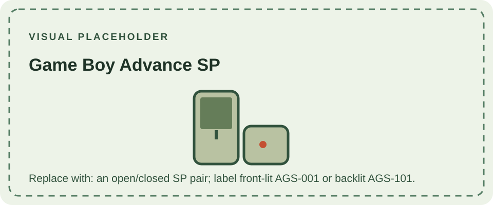

The Game Boy Advance SP (AGS-001) launched in 2003. Its clamshell case protects the screen when closed, and its integrated rechargeable lithium-ion battery replaces the standard AA-cell arrangement of the original Advance. The launch model uses a front-lit reflective display; a later AGS-101 revision introduced a backlit display. These lighting systems are different, and model number alone should be checked when identifying a replacement screen or repair part.

The SP plays Game Boy Advance cartridges and supports Game Boy and Game Boy Color cartridges through its legacy slot. Its compact link connector and lack of a built-in headphone socket mean some original Advance accessories require adapters. As with any hardware revision, compatibility should be checked against the specific accessory.

Compare the landscape [Game Boy Advance](/consoles/game-boy-advance/) and the smaller, GBA-only [Game Boy Micro](/consoles/game-boy-micro/). Nintendo's [SP manual](https://csassets.nintendo.com/noaext/image/private/t_KA_PDF/agsmanual_english?_a=DATC1RAAZAA0) documents its operating controls and charging requirements.
The [cartridge compatibility guide](/cartridges/game-boy-cartridges/) summarizes Game Pak support across the Advance family.

## Sources

- [Nintendo Game Boy Advance SP manual](https://csassets.nintendo.com/noaext/image/private/t_KA_PDF/agsmanual_english?_a=DATC1RAAZAA0) — official operating and safety instructions.
- [Nintendo UK: Nintendo history](https://www.nintendo.com/en-gb/Hardware/Nintendo-History/Nintendo-History-625945.html) — records the 2003 SP launch and later GBA-era releases.
