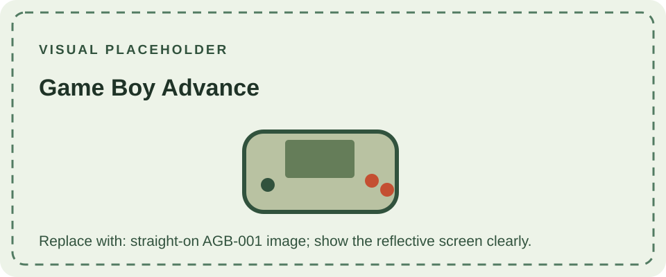

The Game Boy Advance (AGB-001) launched in 2001 and marked a substantial architectural change from the original Game Boy line. Its ARM-based processor and wider screen support more detailed color games, while the landscape form places the controls on either side of the display. The reflective TFT screen has no built-in illumination, making ambient light important for visibility.

The system accepts Game Boy Advance cartridges and can also run original Game Boy and Game Boy Color cartridges in a legacy mode. Compatibility is not universal across every peripheral or accessory, and some later hardware in the family—especially the Game Boy Micro—drops support for older cartridges.

The [Advance SP](/consoles/game-boy-advance-sp/) folds into a compact clamshell and adds a front-lit screen and rechargeable battery. The [Micro](/consoles/game-boy-micro/) is a smaller GBA-only redesign. For the earlier cartridge families, see the [DMG-01](/consoles/dmg-01/overview/) and [Game Boy Color](/consoles/game-boy-color/).
See the [cartridge compatibility guide](/cartridges/game-boy-cartridges/) for the Advance's legacy support and cartridge/save technologies.

## Sources

- [Nintendo UK: Nintendo history](https://www.nintendo.com/en-gb/Hardware/Nintendo-History/Nintendo-History-625945.html) — records the Advance generation and its successors.
- [Nintendo of America: Company history](https://press.nintendo.com/CompanyHistory) — chronology of Game Boy family releases.
