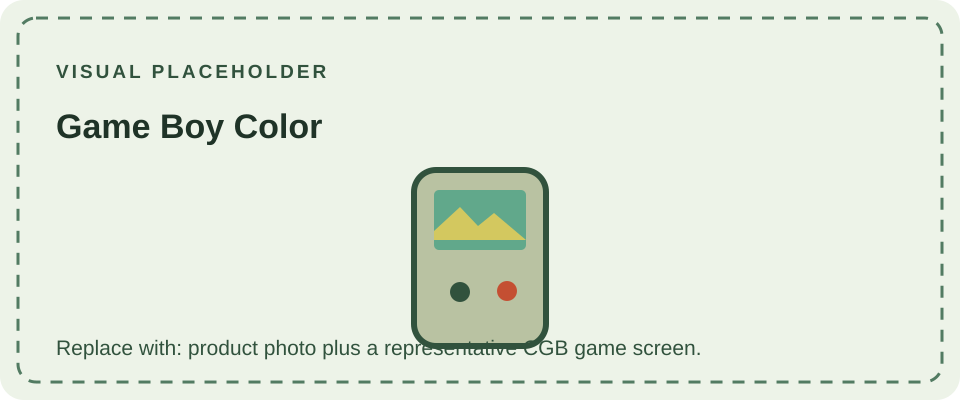

The Game Boy Color (CGB) launched in 1998 with a color reflective LCD and revised hardware. Its CPU can run at the original Game Boy clock or at a doubled speed selected by software, and the system provides additional work and video memory. Games designed for the CGB can use color palettes and hardware features unavailable on earlier monochrome systems.

The CGB also preserves backward compatibility with original Game Boy cartridges. In this compatibility mode, older software receives limited color through system palettes; it does not become a native color game. The cartridge edge connector remains compatible, while the software determines which mode is used.

Regional shell colors and special editions vary. Board markings identify internal revisions, but a shell color alone does not. For earlier monochrome systems, compare the [Pocket](/consoles/game-boy-pocket/) and [Light](/consoles/game-boy-light/); the original model is covered in the [DMG-01 overview](/consoles/dmg-01/overview/). Consult the [technical reference](/reference/example/) for display, CPU, memory, and cartridge concepts.
The [cartridge guide](/cartridges/game-boy-cartridges/) explains Color-only and dual-mode Game Paks, including the limits of cartridge-shell color as an identifier.

## Sources

- [Pan Docs](https://gbdev.io/pandocs/) — community-maintained reference to Game Boy and Color hardware behavior.
- [Game Boy Complete Technical Reference](https://gekkio.fi/files/gb-docs/gbctr.pdf) — system-family and hardware documentation.
