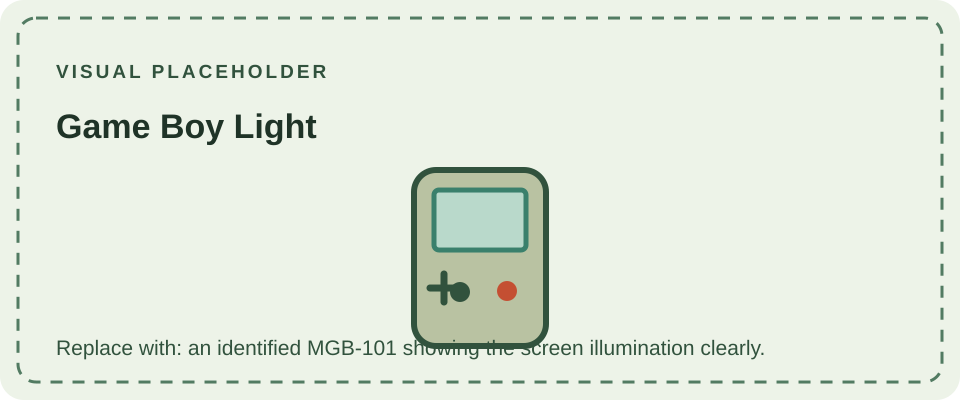

Released in Japan in 1998, the Game Boy Light is closely related to the Game Boy Pocket and plays the same monochrome Game Boy cartridges. Its defining feature is an electroluminescent panel behind the reflective LCD, activated by a dedicated switch. The panel gives the screen a cool blue-green glow in dim environments; it is not the front light or LED backlight used by later systems.

The Light uses two AA batteries, unlike the Pocket's two AAA cells, and has a slightly larger shell to accommodate its lighting hardware. It retains the compact-generation link connector. Its regional release was Japan-only, although imported units later circulated elsewhere.

The illuminated layer adds circuitry and a high-voltage inverter to an otherwise Pocket-like architecture. For the unlit redesign, see [Game Boy Pocket](/consoles/game-boy-pocket/); for the next major monochrome-to-color transition, see [Game Boy Color](/consoles/game-boy-color/). The [Game Boy hardware reference](/reference/example/) summarizes shared platform behavior.
See the [cartridge compatibility guide](/cartridges/game-boy-cartridges/) for supported Game Pak types across the family.

## Sources

- [Game Boy Complete Technical Reference](https://gekkio.fi/files/gb-docs/gbctr.pdf) — model and hardware reference.
- [Game Boy hardware database: Light](https://gbhwdb.gekkio.fi/consoles/mgl/) — photographs and component data for submitted units.
