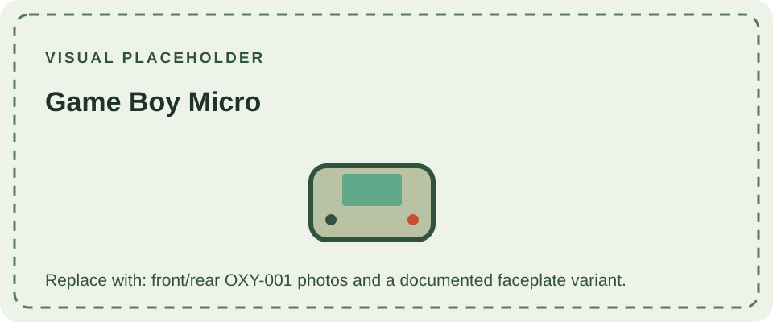

The Game Boy Micro (OXY-001) arrived in 2005 as a highly compact member of the Advance generation. It uses a bright, backlit color screen and interchangeable faceplates on selected editions. Its small controls and display distinguish it from the larger Advance systems.

The Micro plays Game Boy Advance cartridges only. It does not have the earlier cartridge slot used by the original Game Boy and Game Boy Color, so backward compatibility with those libraries is absent. It also uses the compact Advance link connector; check accessory compatibility before connecting older hardware.

The Micro followed the [Game Boy Advance](/consoles/game-boy-advance/) and [Advance SP](/consoles/game-boy-advance-sp/), both of which support a broader cartridge range. Nintendo's [company history](https://www.nintendo.com/au/about/history/) records its 2005 introduction.
For the Micro's GBA-only cartridge support and the systems that accept earlier Game Paks, see the [cartridge compatibility guide](/cartridges/game-boy-cartridges/).

## Sources

- [Nintendo Australia: History](https://www.nintendo.com/au/about/history/) — records the Micro's 2005 launch.
- [Nintendo UK: Nintendo history](https://www.nintendo.com/en-gb/Hardware/Nintendo-History/Nintendo-History-625945.html) — family chronology and compatibility context.
