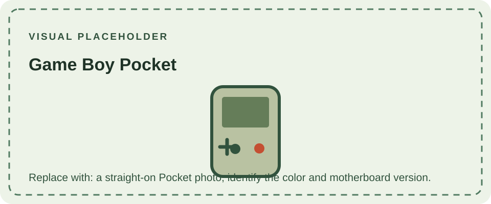

Nintendo introduced the Game Boy Pocket in 1996 as a more compact successor to the DMG-01. Its smaller case and two AAA cells made it easier to carry, while its reflective monochrome LCD offered a sharper, more neutral-looking image than the original's green-tinted display. The screen remained unlit, so visibility still depended on ambient light.

The Pocket plays original Game Boy cartridges and retains monochrome Game Link support. It uses a smaller link connector than the DMG-01, so connecting different generations may require a compatible cable or adapter. The reduced case also changes the battery format and internal board layout; DMG replacement parts are not generally interchangeable.

Early Pocket units and later production runs have board revisions and indicator-light differences. Identify a unit by its model marking and board number rather than assuming all color shells share one internal configuration. The [Game Boy Light](/consoles/game-boy-light/) uses the Pocket-era design with an electroluminescent lighting layer, while the [Game Boy Color](/consoles/game-boy-color/) is a distinct color-capable system.

For the platform's shared processor, display, audio, and cartridge behavior, see the [Game Boy technical reference](/reference/example/).
The [cartridge compatibility guide](/cartridges/game-boy-cartridges/) compares the Pocket with every other Game Boy system.

## Sources

- [Nintendo of America: Company history](https://press.nintendo.com/CompanyHistory) — records the Pocket's 1996 introduction.
- [Game Boy Complete Technical Reference](https://gekkio.fi/files/gb-docs/gbctr.pdf) — documents model families and hardware.
