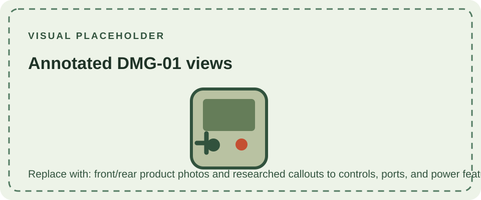

The Game Boy name describes a family of Nintendo handhelds that began with the DMG-01 in 1989. Across several generations, Nintendo revised the original monochrome system, added color, and later introduced a new processor architecture while maintaining compatibility links between selected models.

## Original monochrome line

The [DMG-01](/consoles/dmg-01/overview/) established the cartridge-based platform with a reflective monochrome display and replaceable AA batteries. The [Game Boy Pocket](/consoles/game-boy-pocket/) made that design smaller, and the Japan-only [Game Boy Light](/consoles/game-boy-light/) added an electroluminescent screen panel.

The [Game Boy Color](/consoles/game-boy-color/) added native color graphics and new hardware while retaining compatibility with original Game Boy software. The [Game Boy Advance](/consoles/game-boy-advance/) began the next architectural generation, followed by the folding [Advance SP](/consoles/game-boy-advance-sp/) and compact [Game Boy Micro](/consoles/game-boy-micro/).

## Technical context

These systems share a family identity, but they do not all use the same processor, screen, cartridge support, battery design, or link connector. The [Model Comparison](/consoles/model-comparison/) sets these differences side by side, and the [technical reference](/reference/example/) summarizes core platform concepts and compatibility boundaries. Individual model pages describe the differences that matter for identification and use.

## Where to go next

- **Identifying a console:** [Model Codes & Identification](/collecting/identification/) lists every model number and explains how to build an evidence-based identification.
- **Diagnosing a fault:** [Repair & Troubleshooting](/repair/overview/) starts from the symptom and links to the relevant hardware pages.
- **Cartridges:** [Game Boy Cartridges](/cartridges/game-boy-cartridges/) covers formats, saves, and compatibility across every model.
- **Terminology:** the [Glossary](/reference/glossary/) defines model codes and hardware terms used throughout the archive.
