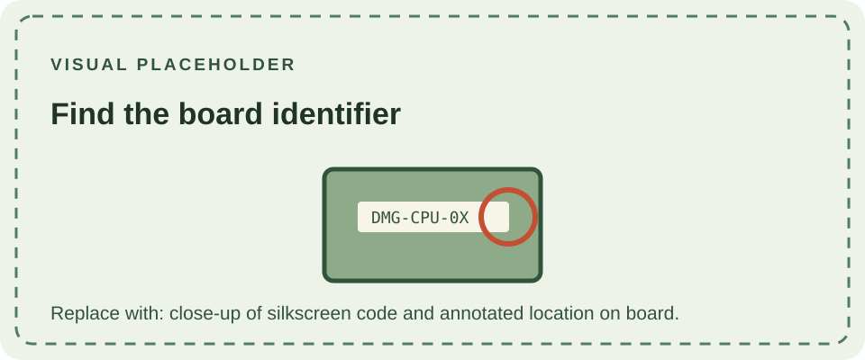

The DMG-01 uses several circuit boards, and each may carry its own revision identifier. This procedure identifies the main CPU board without confusing it with the display or power assemblies.

## Procedure

1. Switch the console off and remove its batteries and any external power supply.
2. Remove the rear case only if you are equipped to do so safely; use the correct driver and avoid pulling on the display ribbon or speaker wires.
3. Locate the silkscreen marking on the main board. DMG-CPU-01 through DMG-CPU-08 are main-board identifiers; record the full text exactly.
4. Photograph both sides and separately record the LCD, DC converter, and headphone-jack board markings if visible.
5. Reassemble carefully and test the system with a compatible power source and cartridge.

The board number cannot reliably establish the console's serial date, shell originality, or regional origin. Review the [DMG-CPU revision pages](/consoles/dmg-01/pcbs-revisions/dmg-cpu-01/) for comparison, and see the [hardware database](https://gbhwdb.gekkio.fi/consoles/dmg/) for community-submitted examples.
