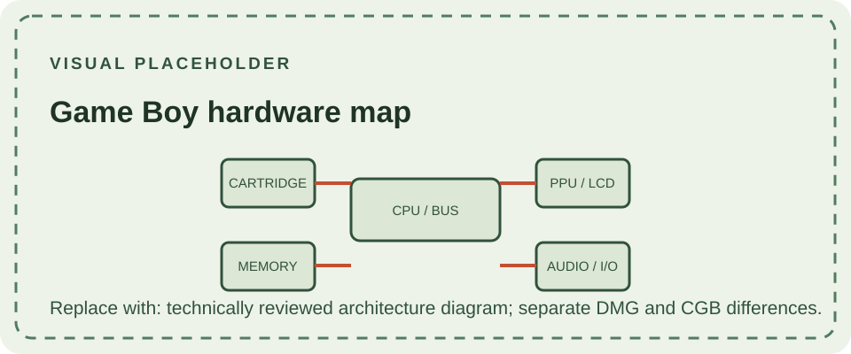
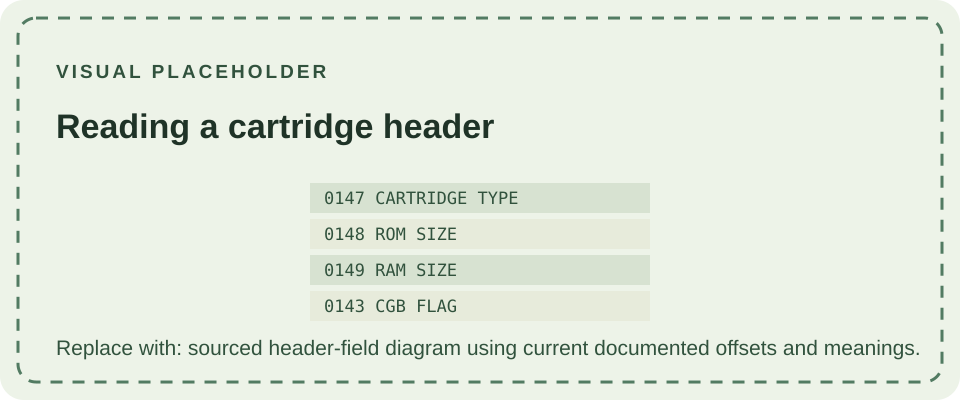

This reference summarizes shared hardware concepts for the original monochrome Game Boy and the closely related Pocket and Light systems. The Game Boy Color and Advance generations add different capabilities; follow the linked model pages for their differences. For precise register behavior, consult the maintained [Pan Docs technical reference](https://gbdev.io/pandocs/) and the [Game Boy Complete Technical Reference](https://gekkio.fi/files/gb-docs/gbctr.pdf).

## Processor and clocks

The original Game Boy uses a Sharp SM83-family 8-bit processor, often informally called the LR35902. It has an instruction set related to, but not identical with, the Intel 8080 and Zilog Z80. The DMG clock is approximately 4.194304 MHz. Describing it simply as a Z80 can mislead emulator and software work because instructions and hardware behavior differ.

## Memory and address space

The CPU accesses a 16-bit address space through memory-mapped regions. These include cartridge ROM and external cartridge hardware, internal working RAM, video RAM, object attribute memory, I/O registers, and high RAM. The original DMG has 8 KiB of internal working RAM and 8 KiB of video RAM; cartridge boards can add bank switching and external memory. A memory bank controller (MBC) lets software address more cartridge ROM or RAM than the base address window can expose at once.

Save behavior depends on the cartridge. Some cartridges use battery-backed SRAM; others use different save technologies or no save memory. Removing the console's batteries does not erase a cartridge save, although a depleted cartridge battery can eventually prevent battery-backed RAM from retaining data.

## Display and graphics

The LCD has a resolution of 160 × 144 pixels and displays four gray-green shades through a reflective panel. The pixel values are not fixed RGB colors: software maps pixel values through palettes, and the physical LCD gives them their characteristic appearance. There is no built-in illumination on the DMG, Pocket, or standard Color model.

The picture is composed from background and window tile maps plus movable object entries (sprites). The PPU restricts how many objects can be drawn on a scanline, so games must schedule sprites carefully. Timing around LCD modes and scanlines is observable by software and is important for accurate emulation.

## Audio

The original system provides four sound channels: two pulse-wave channels, one programmable wave channel, and one noise channel. Software controls them through memory-mapped registers, and the analog output stage mixes the channels for the speaker and headphone output. Electrical revision and volume settings can affect audible noise and balance; an emulator's idealized output may not reproduce every analog characteristic.

## Cartridges and compatibility

Cartridges connect through a 32-pin edge interface and may contain ROM, an MBC, RAM, a real-time clock, or other game-specific circuitry. The cartridge header identifies the title and declares hardware requirements. Physical fit does not guarantee compatibility: the Game Boy Color has exclusive software, while dual-mode releases can select an older-compatible mode on DMG and Pocket systems.

The [DMG-01 overview](/consoles/dmg-01/overview/) and [cartridge-slot notes](/consoles/dmg-01/physical-design/cartridge-slot/) connect these concepts to the original hardware. The [Game Boy Color](/consoles/game-boy-color/) introduces color-mode differences; the [Game Boy Advance](/consoles/game-boy-advance/) belongs to a newer architecture, even though it retains backward support for earlier Game Boy cartridges.

For cartridge families, save methods, and model compatibility, see the dedicated [Game Boy Cartridges reference](/cartridges/game-boy-cartridges/).

## Link port and peripherals

The serial link port can exchange data with another compatible system or peripheral. Games define the data protocol and timing; the connector alone does not guarantee that two accessories can communicate. DMG and later systems use different connector arrangements, which is why cross-generation cables and adapters matter. The Super Game Boy is a separate SNES accessory that runs Game Boy software with additional presentation features.

## Sources

- [Pan Docs](https://gbdev.io/pandocs/) — community-maintained technical documentation of the Game Boy hardware.
- [Game Boy Complete Technical Reference](https://gekkio.fi/files/gb-docs/gbctr.pdf) — hardware reference covering system families, processors, and revisions.
- [Nintendo Game Boy programming manual](https://files.nekoblog.org/uploads/pdf/39999184-GameBoy-Programming-Manual.pdf) — Nintendo's software-development reference.
